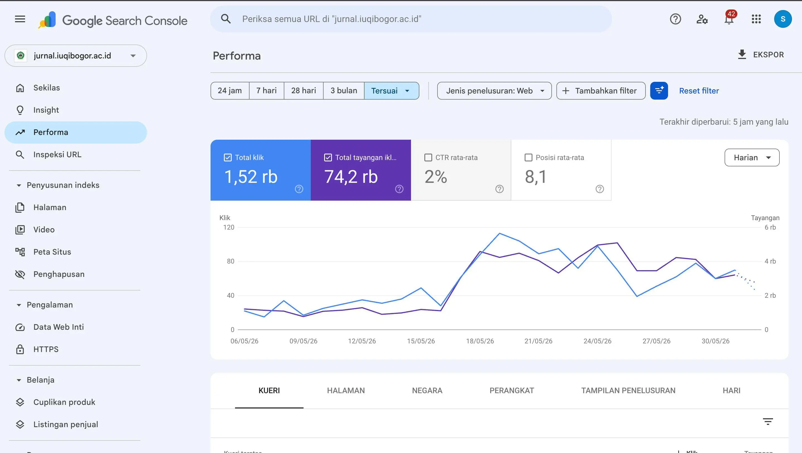

## Kebutuhan: artikel berkualitas yang lebih mudah ditemukan

Jurnal ilmiah IUQI memiliki konten berkualitas. Agar artikel-artikelnya menjangkau lebih banyak pembaca dan peneliti, jurnal perlu fondasi SEO teknis yang dipahami mesin pencari akademik:

- **Metadata standar** — Dublin Core dan OAI-PMH, agar Google Scholar dan agregator membaca artikel dengan akurat.
- **Sitemap lengkap** — supaya crawler menemukan setiap issue dan artikel baru dengan cepat.
- **Halaman yang cepat** — mesin pencari memprioritaskan situs yang ringan.
- **Struktur halaman yang jelas** — heading dan markup yang menggambarkan isi artikel.

## Yang kami kerjakan

- **Metadata Dublin Core** — setiap artikel dilengkapi metadata author, title, abstract, date, dan identifier. Google Scholar bisa membaca dan mengindeks artikel dengan akurat.
- **OAI-PMH** — protokol standar untuk harvesting metadata. Jurnal IUQI kompatibel dengan agregator dan repositori akademik global.
- **Sitemap XML** — semua halaman jurnal — homepage, issue, artikel — terdaftar di sitemap.
- **Optimasi kecepatan** — kompresi, caching, dan optimasi gambar. Waktu muat kini di bawah 1,5 detik.
- **Struktur heading semantik** — H1, H2, H3 ditata sesuai hierarki konten.
- **Schema.org markup** — artikel ilmiah diberi markup `ScholarlyArticle` untuk rich snippets di hasil pencarian.

## Hasil

| Aspek | Hasil |
|-------|-------|
| Impresi | 74.000 dalam 1 bulan |
| Kecepatan halaman | <1,5 detik |
| Metadata Dublin Core | Lengkap |
| OAI-PMH | Aktif |
| Google Scholar | Artikel terindeks lebih cepat |

## FAQ

> [!tip]+ **Apakah optimasi SEO ini permanen?**
> Fondasi teknis yang kami bangun — metadata, sitemap, OAI-PMH, struktur heading — bersifat permanen dan tidak perlu diulang. Konten artikel baru akan otomatis mengikuti standar yang sama. Kami serahkan dokumentasi lengkap agar tim Anda bisa melanjutkan pengelolaan.

> [!tip]- **Berapa lama hasil SEO mulai terlihat?**
> Google butuh waktu untuk re-crawl dan re-index. Dalam kasus IUQI, kenaikan impresi mulai terlihat dalam 2-3 minggu setelah optimasi. Hasil penuh biasanya tercapai dalam 1-2 bulan.

> [!tip]- **Apakah optimasi ini cukup untuk terindeks SINTA?**
> Fondasi teknis adalah syarat wajib — tapi tidak cukup sendiri. Indeks SINTA juga mempertimbangkan kualitas artikel, sitasi, dan kepatuhan administratif. Kami bantu siapkan semua persyaratan teknis: sitemap, metadata Dublin Core, OAI-PMH, dan template sesuai standar Arjuna. Sisanya tergantung pada kualitas konten jurnal Anda.
